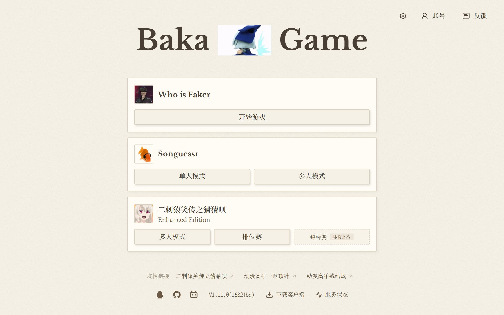
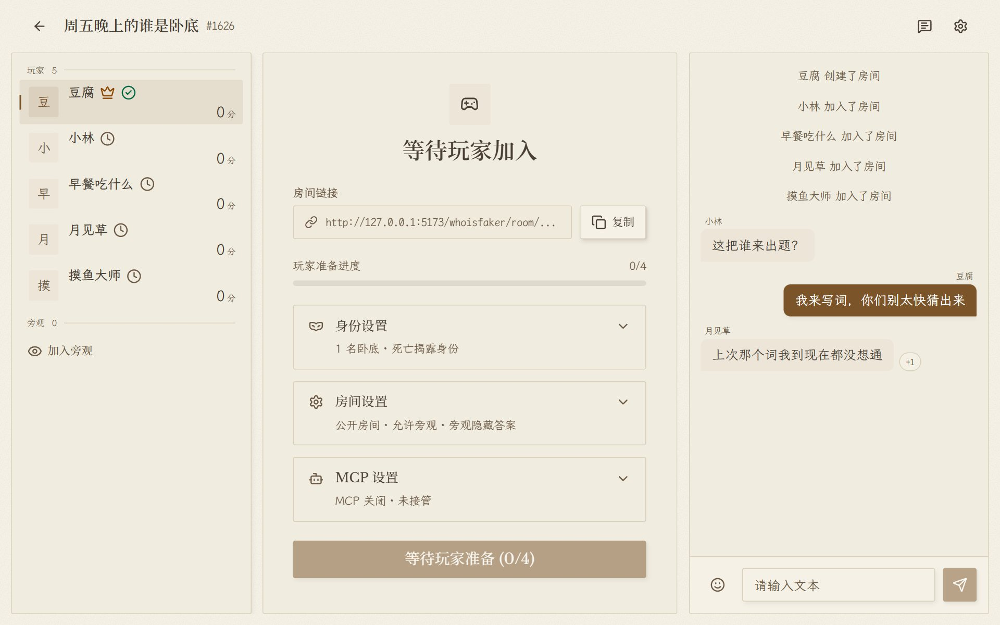

# BakaGame

**1000万以内最好玩的小游戏网站。** 一间开给二次元朋友的游戏室：开一间房，把房号发进群，人齐就开。

BakaGame is an open-source, Chinese-language party game site for anime fans: Who is Faker (a word-deduction game), Songuessr (guess the song or the anime it came from) and CEE (guess the anime character).

[开始玩](https://game.baka.website) · [反馈问题](https://github.com/Cosmosuperbaka/BakaGame/issues/new/choose) · [参与贡献](CONTRIBUTING.md) · [更新日志](https://game.baka.website/abouts?tab=changelog)

<p>
  
  
</p>

## 三款游戏

| 游戏 | 玩什么 | 开局条件 |
|---|---|---|
| [Who is Faker](https://game.baka.website/whoisfaker) | 出题人现场写词的谁是卧底。谁都不知道自己拿的是平民词还是卧底词，投票之后还要入夜，平民动刀，倒下的是自己。 | 4 名参战玩家加 1 名出题人 |
| [Songuessr](https://game.baka.website/songuessr) | 听片段猜歌名，或者猜这首歌出自哪部番。曲库来自网易云音乐与 QQ 音乐，番剧资料来自 Bangumi，也能用自己的歌单出题。 | 房间里至少一人登录音乐账号，可单人玩 |
| [CEE](https://game.baka.website/cee) | 二刺猿笑传之猜猜呗增强版。全房猜同一个动漫角色，靠 Bangumi 资料给出的线索一路排除，能组队、能 BP，也能进原版房间。 | 至少 2 人 |

普通房间进门只要一个昵称。建房后把链接或四位房号发给朋友，手机和电脑可以进同一间房。

## 玩家：遇到问题或有想法

- 站内右上角有反馈入口，不懂 GitHub 也能用。
- 想留下公开记录，就[提一个 Issue](https://github.com/Cosmosuperbaka/BakaGame/issues/new/choose)，模板都是中文，照着填就行。
- 更多参与方式见 [CONTRIBUTING](CONTRIBUTING.md#玩家)。

## 开发者：本地跑起来

需要 [Node.js](https://nodejs.org)、[pnpm](https://pnpm.io) 和 [Bun](https://bun.sh)，版本要求见根 `package.json`。

```bash
git clone https://github.com/Cosmosuperbaka/BakaGame.git
cd BakaGame
pnpm install
cp Server/.env.example Server/.env
cp Client/.env.example Client/.env
pnpm dev
```

猜歌和猜角色依赖不进 Git 的 Bangumi 数据集，说明见 [Server/data/README.md](Server/data/README.md)。提交代码前请读 [CONTRIBUTING](CONTRIBUTING.md#开发者)。

房间号 `Oblivionis` 是专用测试房，带调试控制台，可以跳阶段、加机器人，适合本地试玩法。它缺省关闭（关闭时是非法房号）：本地要用，需在自己的 `Server/.env` 里把 `ENABLE_TEST_ROOMS` 设为 `true`；生产不得打开。

## 项目结构

| 目录 | 说明 |
|---|---|
| `Server/` | 服务端，Bun + Elysia，持有全部对局状态 |
| `Client/` | 客户端，React + Vite |
| `Server/src/shared/` | 双端共用的模型与协议，客户端经 `@bakagame/shared` 引用 |
| `Desktop/`、`Mobile/` | Windows 与 Android 客户端外壳 |
| `Agents/` | 跨包工程规范，入口见 [AGENTS.md](AGENTS.md) |

## 许可证

[AGPL-3.0](LICENSE)。安全问题请按 [SECURITY](SECURITY.md) 私下报告，社区约定见 [CODE_OF_CONDUCT](CODE_OF_CONDUCT.md)。
